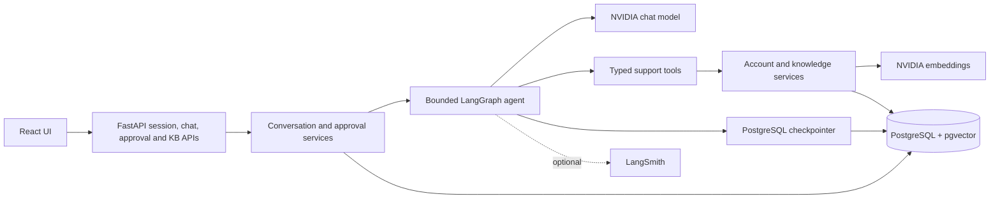
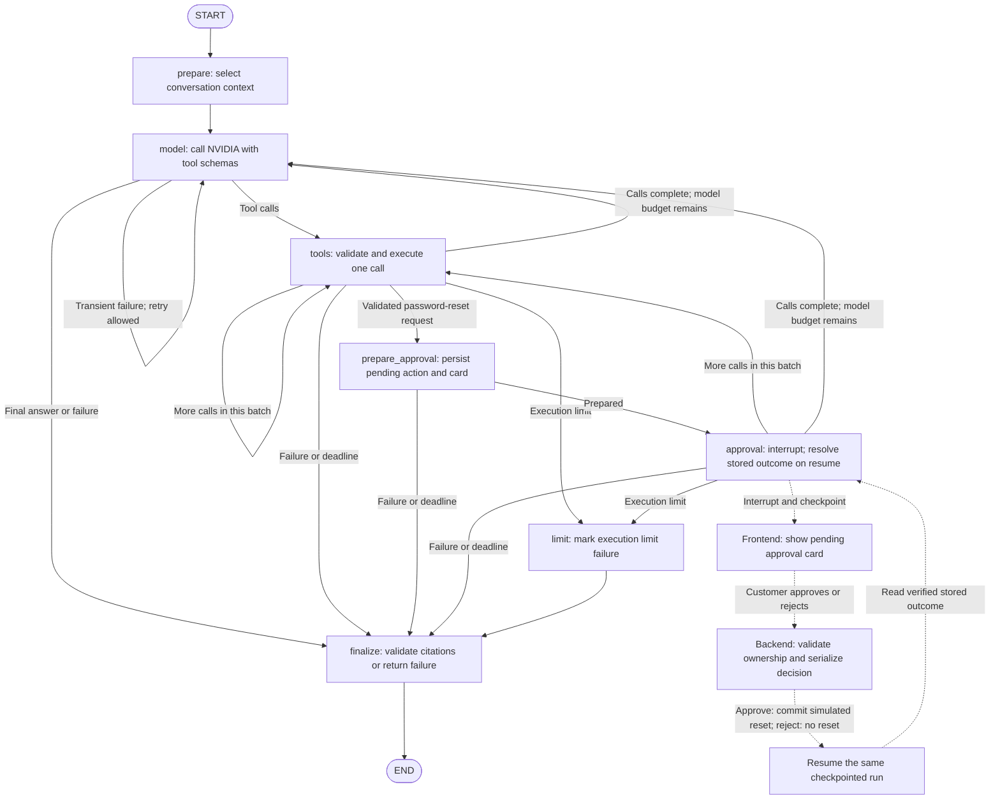
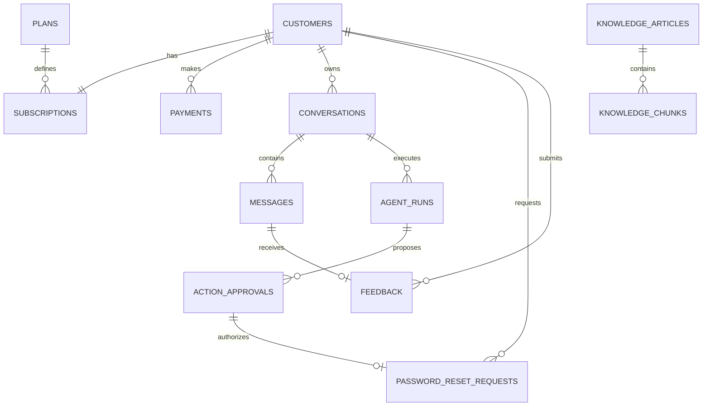

# AI Support Agent

A local support demo for a fictional subscription service. A LangGraph agent answers questions using a knowledge base, looks up account data and requests a **simulated** password reset after confirmation. The React interface streams answers and stores conversations and feedback.

**Demo only:** Anyone can select a customer profile or enter the knowledge administration area. This is not production authentication. Password resets do not change credentials or send email, and their links do not work. Chat content is sent to NVIDIA; do not enter sensitive information.

## Requirements

- A Bash environment (on Windows, use WSL2) and Docker with Compose and a running Docker daemon
- Python 3.12, [uv](https://docs.astral.sh/uv/), Node.js and npm
- `curl` and an [NVIDIA API key](https://build.nvidia.com/) with access to the configured chat and embedding models

The default ports are **5432** (PostgreSQL), **8080** (Adminer), **8000** (API) and **5173** (frontend).

## Quick start

Run these commands from the repository root:

1. **Create configuration files:**

   ```bash
   cp .env.example .env
   cp backend/.env.example backend/.env
   ```

2. **Configure credentials:**
   - In the root `.env`, set `NVIDIA_API_KEY` to your NVIDIA key.
   - In `backend/.env`, replace `SESSION_SECRET` with a random value. You can generate one with `python3 -c 'import secrets; print(secrets.token_urlsafe(32))'`.
   - Do not commit either `.env` file. Shell environment variables override both files; when the same setting appears in both, the root `.env` takes precedence.

3. **Start the application:**

   ```bash
   ./start.sh
   ```

   The script starts Docker, installs missing dependencies, initializes the database and starts the API and frontend. On first startup it seeds six fictional customers and 16 knowledge articles; indexing the articles requires NVIDIA access and can take time.

4. **Open the app:** [http://localhost:5173](http://localhost:5173). Choose a profile to chat, or select **Manage the knowledge guide** to edit articles.

   Try asking “What is my current subscription?”, “What is the refund policy?” or “Reset my password.” A reset requires your explicit confirmation and is simulated.

5. **Stop the app when finished:**

   ```bash
   ./stop.sh
   ```

   This stops the script-managed API and frontend and this project's Docker services. Database volumes and data are retained.

## API documentation

- **Interactive FastAPI/Swagger documentation:** [http://localhost:8000/docs](http://localhost:8000/docs) while the app is running.
- **[API contract](API_CONTRACT.md):** request and response formats, streaming events, approval behavior and error handling.

Customer endpoints require a demo customer session. Knowledge CRUD requires the separate demo-admin session; from Swagger, call `POST /knowledge/session` before trying those endpoints. Neither session is real authentication.

## Data, seeding and troubleshooting

- **First-time indexing:** Provider failures retry with backoff until they succeed. Invalid credentials can also keep retrying: check the key, press **Ctrl+C** to stop, then rerun `./start.sh` to resume. Successfully indexed articles are retained.
- **Refresh demo data:** Stop the app first if it is running, then run `./start.sh --seed` to refresh the seeded subscriptions, payments and dates and add missing seed articles. Existing articles with matching titles are not overwritten. Normal restarts do not restore deliberately deleted articles.
- **Ports in use:** To change PostgreSQL's host port, set `POSTGRES_PORT` in the root `.env` and use the same port in both `DATABASE_URL` and `TEST_DATABASE_URL` there. For API or frontend conflicts, run, for example, `API_PORT=8001 FRONTEND_PORT=5174 ./start.sh`; the script configures the frontend and CORS accordingly. The default Adminer port is 8080.
- **Logs:** `./start.sh` prints the runtime log directory. If startup fails, check those logs and the terminal output; Docker services may still be running.
- **Database access:** Adminer is at [http://localhost:8080](http://localhost:8080): server `db`, username `support`, password `support`, database `support_agent`. These credentials are for local development only.
- **Reset warning:** `docker compose down -v` deletes the database volume, including both application and test databases. Use it only if you intend to erase all local data.

Run one backend worker per database. Startup marks interrupted running turns as failed, while preserving pending approvals and committed action outcomes. Optional LangSmith tracing is off by default; see [backend setup](backend/README.md) before enabling it because trace data is sent to that service.

## Tests and evaluation

With Docker running:

```bash
cd backend
uv run pytest -q                     # uses TEST_DATABASE_URL only
uv run ruff check src tests scripts
uv run python -m scripts.evaluate_agent  # optional: real NVIDIA calls

cd ../frontend
npm run build
```

Never point `TEST_DATABASE_URL` at the application database. The optional evaluation uses fictional test data, incurs provider usage and requires manual review of model answers.

The latest recorded checks passed **82 backend tests**, Ruff and the frontend build. Earlier real-model checks passed the refund, subscription, failed-payment and approval-bypass cases three times each. Reset approval and rejection were also checked against database outcomes. Initial model explanations included misleading reset/cancellation wording and an unsupported billing prediction; subsequent checks improved, but model output remains nondeterministic. Persisted outcomes and approval cards—not model explanations—are authoritative. See [BUILD_PLAN.md](BUILD_PLAN.md) for the recorded cases and remaining delivery checks.

## Architecture



### LangGraph agent flow

Solid edges show graph execution; dashed edges show the external approval boundary. Node names match `backend/src/support_agent/agent/graph.py`.



Before the graph runs, the backend checks ownership, reserves the run and saves the customer message. The tools execute sequentially; reset preparation creates a pending card, not a reset. The approval decision is processed **outside** the graph before the checkpointed run resumes. Streamed text is provisional; final messages and action outcomes are persisted. The shared router also declares a `prepare_approval` route from `approval`; normal resumption clears the approval flag, so that route is omitted above.

### Data relationships



Application data and LangGraph checkpoints are stored separately. Article and embedding updates are atomic; customer identity is resolved from the signed demo session, not supplied by the model.

## Project documents

- [API_CONTRACT.md](API_CONTRACT.md) — API schemas, behavior and errors; use alongside [Swagger](http://localhost:8000/docs).
- [SPEC.md](SPEC.md) — application requirements, business rules and design scope.
- [BUILD_PLAN.md](BUILD_PLAN.md) — implementation tasks, evaluation cases and remaining checks.
- [backend/README.md](backend/README.md) — backend configuration, provider details and manual commands.
- [frontend/README.md](frontend/README.md) — frontend setup and implementation notes.
- [frontend/PRODUCT.md](frontend/PRODUCT.md) and [frontend/DESIGN.md](frontend/DESIGN.md) — frontend product context and visual design guidance.
- [AGENTS.md](AGENTS.md) — project instructions for coding agents.
